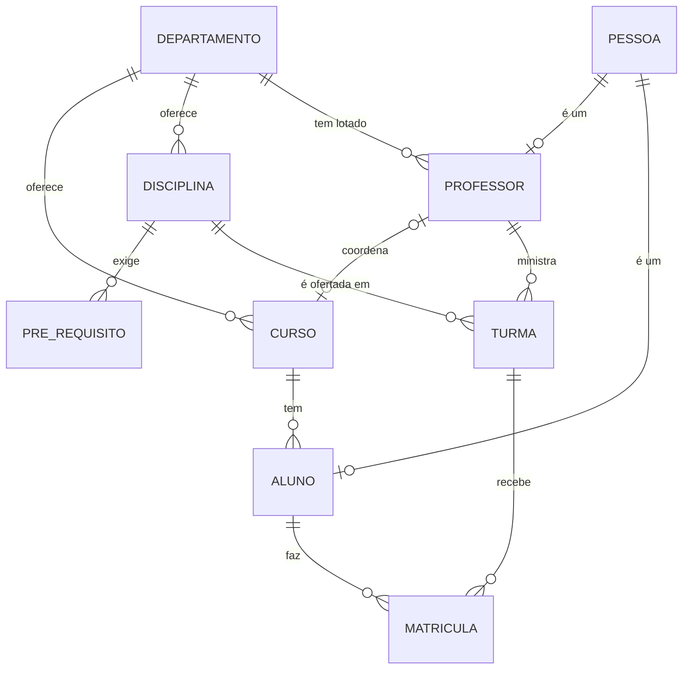

<div align="center">

# Banco de Dados com PostgreSQL

Do modelo conceitual às consultas avançadas: um sistema acadêmico completo,
modelado, normalizado, implementado e testado em PostgreSQL.

[](https://github.com/BrenoSalgado/banco-de-dados-postgresql/actions/workflows/ci.yml)


[](LICENSE)

</div>

---

## Sobre

Repositório de estudos de **Banco de Dados**. Em vez de consultas soltas, todo o conteúdo
gira em torno de um único domínio — uma universidade com departamentos, cursos, professores,
alunos, disciplinas, turmas e matrículas — percorrendo o caminho completo de um projeto de banco:

1. **Modelagem conceitual** (ER estendido) → [`docs/01-modelo-conceitual.md`](docs/01-modelo-conceitual.md)
2. **Normalização** (1FN → 2FN → 3FN) → [`docs/02-normalizacao.md`](docs/02-normalizacao.md)
3. **Álgebra relacional** e sua tradução para SQL → [`docs/03-algebra-relacional.md`](docs/03-algebra-relacional.md)
4. **Implementação e consultas** em SQL → [`sql/`](sql)

Todos os scripts rodam do zero a cada push no **GitHub Actions**, e um conjunto de testes em
PL/pgSQL verifica as restrições e regras de negócio.

## Modelo



Destaques do modelo: **especialização total e disjunta** (pessoa → professor/aluno),
**auto-relacionamento N:N** (pré-requisitos), **relacionamento N:N com atributos** (matrícula)
e **atributo derivado** como coluna gerada (situação = aprovado/reprovado/cursando).

## Conteúdo dos scripts

| Script | O que pratica |
|---|---|
| [`01_schema.sql`](sql/01_schema.sql) | DDL: `PRIMARY KEY`, `FOREIGN KEY` com `ON DELETE`, `UNIQUE`, `CHECK` com regex, colunas `IDENTITY` e `GENERATED`, `COMMENT ON` |
| [`02_dados.sql`](sql/02_dados.sql) | DML: carga de dados de exemplo (fictícios) e ajuste de sequências |
| [`03_consultas_basicas.sql`](sql/03_consultas_basicas.sql) | Seleção e projeção, `LIKE`/`ILIKE`, `BETWEEN`, `IN`, `IS NULL`, `DISTINCT`, `CASE`, funções de data |
| [`04_juncoes_e_agregacoes.sql`](sql/04_juncoes_e_agregacoes.sql) | `INNER`/`LEFT JOIN`, auto-junção, anti-junção, `GROUP BY`/`HAVING`, `FILTER`, `ROLLUP`, `UNION`/`INTERSECT`/`EXCEPT`, **divisão relacional** |
| [`05_subconsultas_cte_janela.sql`](sql/05_subconsultas_cte_janela.sql) | Subconsultas escalares, correlacionadas, `EXISTS`, tabela derivada, **CTE recursiva**, funções de janela (`RANK`, `DENSE_RANK`, `LAG`, agregados em janela) |
| [`06_views_funcoes_triggers.sql`](sql/06_views_funcoes_triggers.sql) | Views, funções SQL e PL/pgSQL (incluindo uma que retorna tabela), **triggers de regra de negócio** e auditoria |
| [`07_indices_e_transacoes.sql`](sql/07_indices_e_transacoes.sql) | Índices comuns, de expressão e parciais, `EXPLAIN`, `BEGIN`/`COMMIT`/`ROLLBACK`, `SAVEPOINT`, tratamento de exceção, níveis de isolamento |
| [`99_testes.sql`](sql/99_testes.sql) | Testes automatizados com `ASSERT` (rodam em transação e terminam em `ROLLBACK`) |

### Regras de negócio implementadas no banco

| Regra | Como |
|---|---|
| Nota entre 0 e 10, frequência entre 0 e 100% | `CHECK` |
| Situação sempre coerente com nota e frequência | coluna `GENERATED ALWAYS AS ... STORED` |
| Não matricular em turma lotada (seguro com acessos simultâneos) | trigger + `SELECT ... FOR UPDATE` |
| Não matricular sem ter sido aprovado nos pré-requisitos | trigger que lista os pré-requisitos faltantes |
| Uma pessoa não pode ser professor e aluno ao mesmo tempo | trigger nas duas subclasses |
| Toda alteração de nota fica registrada (quem, quando, de/para) | trigger `AFTER UPDATE ... WHEN (OLD.nota IS DISTINCT FROM NEW.nota)` |

## Exemplos

**CTE recursiva** — todos os pré-requisitos (diretos e indiretos) de Inteligência Artificial:

```sql
WITH RECURSIVE cadeia (disciplina_id, nivel) AS (
    SELECT pr.requisito_id, 1
    FROM pre_requisito pr JOIN disciplina d ON d.id = pr.disciplina_id
    WHERE d.codigo = 'COMP401'
  UNION
    SELECT pr.requisito_id, c.nivel + 1
    FROM cadeia c JOIN pre_requisito pr ON pr.disciplina_id = c.disciplina_id
)
SELECT d.codigo, d.nome, min(c.nivel) AS nivel
FROM cadeia c JOIN disciplina d ON d.id = c.disciplina_id
GROUP BY d.codigo, d.nome
ORDER BY nivel, d.codigo;
```

```text
 codigo  |            nome             | nivel
---------+-----------------------------+-------
 COMP201 | Estruturas de Dados         |     1
 EST101  | Probabilidade e Estatística |     1
 COMP102 | Algoritmos e Programação II |     2
 MAT101  | Cálculo I                   |     2
 MAT103  | Matemática Discreta         |     2
 COMP101 | Algoritmos e Programação I  |     3
```

**Agregação com `FILTER`** — desempenho por turma:

```text
 periodo |           disciplina            | alunos | media | pct_aprovacao
---------+---------------------------------+--------+-------+---------------
 2025/1  | Algoritmos e Programação I      |     13 |  7.88 |          92.3
 2025/1  | Cálculo I                       |     15 |  7.63 |          86.7
 2025/1  | Geometria Analítica             |     12 |  8.08 |          83.3
 2025/1  | Matemática Discreta             |     17 |  8.01 |          82.4
 2025/2  | Algoritmos e Programação II     |     12 |  6.54 |          83.3
 2025/2  | Probabilidade e Estatística     |      9 |  6.86 |          66.7
 2025/2  | Programação Orientada a Objetos |     12 |  7.88 |          91.7
```

**Trigger em ação** — tentativa de matrícula em turma cheia:

```text
NOTICE:  Matrícula recusada como esperado: Turma 9 está lotada (4 de 4 vagas ocupadas)
```

## Como executar

Requisito: PostgreSQL 13+ (testado no 18).

```bash
git clone https://github.com/BrenoSalgado/banco-de-dados-postgresql.git
cd banco-de-dados-postgresql
psql -U postgres -d postgres -f executar_tudo.sql
```

O script cria o schema `academico` (apagando-o antes, se existir), carrega os dados, roda todas
as consultas e, no fim, os testes. Para rodar um arquivo isolado depois da carga:

```bash
psql -U postgres -d postgres -f sql/05_subconsultas_cte_janela.sql
```

## Estrutura do projeto

```text
.
├── docs/                 # modelagem, normalização e álgebra relacional
├── sql/                  # scripts numerados na ordem de execução
├── executar_tudo.sql     # roda tudo em sequência
└── .github/workflows/    # CI: sobe um PostgreSQL e executa todos os scripts
```

> Todos os nomes e dados são fictícios.

## Licença

[MIT](LICENSE)
