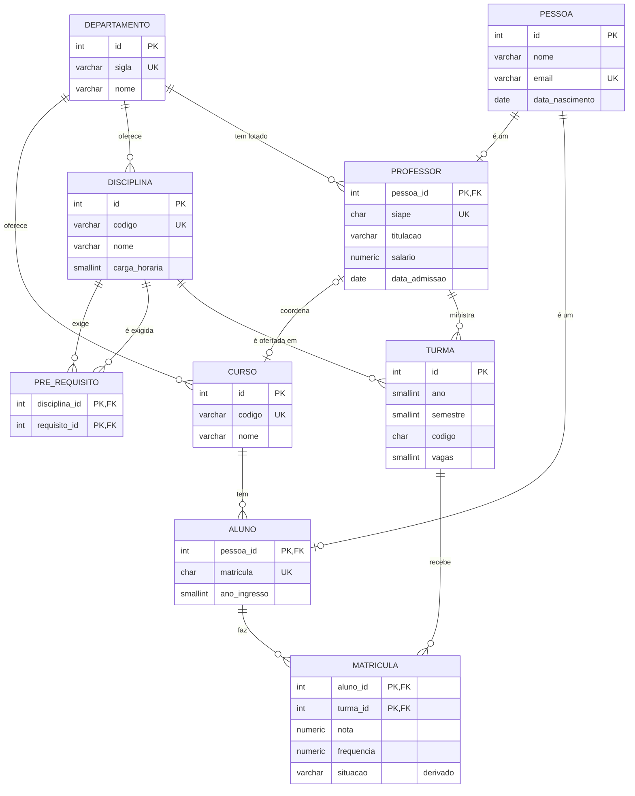

# 1. Modelo conceitual (ER estendido) e mapeamento para o relacional

## Minimundo

Uma universidade é organizada em **departamentos**. Cada departamento oferece **cursos** e
**disciplinas** e tem **professores** lotados nele. Professores e alunos são **pessoas**
(ninguém é as duas coisas ao mesmo tempo). Cada curso é coordenado por um professor.
Disciplinas podem exigir outras como **pré-requisito**. A cada semestre, disciplinas são
ofertadas em **turmas**, ministradas por um professor, nas quais os alunos se **matriculam**;
ao fim do semestre cada matrícula recebe nota e frequência.

## Diagrama ER

## Decisões de modelagem

| Conceito do ER | Onde aparece | Como foi mapeado |
|---|---|---|
| **Especialização total e disjunta** | `PESSOA` → `PROFESSOR`, `ALUNO` | Uma tabela por classe; a PK da subclasse é FK para `pessoa`. A disjunção é garantida por trigger (`fn_especializacao_disjunta`). |
| **Relacionamento 1:N** | departamento–curso, curso–aluno, professor–turma… | FK no lado N. |
| **Relacionamento 1:1 parcial** | professor *coordena* curso | FK `coordenador_id` com `UNIQUE` em `curso` (o lado que sempre tem coordenador). |
| **Relacionamento N:N com atributos** | aluno *matricula-se em* turma | Tabela própria `matricula`, PK composta `(aluno_id, turma_id)` e atributos `nota`, `frequencia`. |
| **Auto-relacionamento N:N** | disciplina *é pré-requisito de* disciplina | Tabela `pre_requisito` com duas FKs para `disciplina` e `CHECK` impedindo auto-referência. |
| **Atributo derivado** | situação da matrícula | Coluna gerada (`GENERATED ALWAYS AS ... STORED`) a partir de nota e frequência. |
| **Entidade fraca (conceitualmente)** | turma depende de disciplina | Chave natural `UNIQUE (disciplina_id, ano, semestre, codigo)`; usamos `id` substituto para simplificar as FKs. |

## Restrições de integridade

- **De domínio** (`CHECK`): nota entre 0 e 10, frequência entre 0 e 100, semestre ∈ {1, 2},
  titulação ∈ {Graduado, Mestre, Doutor}, carga horária múltipla de 15, formato de e-mail, SIAPE e matrícula.
- **De chave** (`PRIMARY KEY`, `UNIQUE`): e-mail, SIAPE, matrícula, códigos de curso e disciplina.
- **Referencial** (`FOREIGN KEY`): com `ON DELETE CASCADE` onde a linha dependente não faz sentido sozinha
  (subclasses, matrículas) e `ON DELETE SET NULL` para o coordenador.
- **Semânticas** (triggers): turma lotada, pré-requisitos e especialização disjunta.
